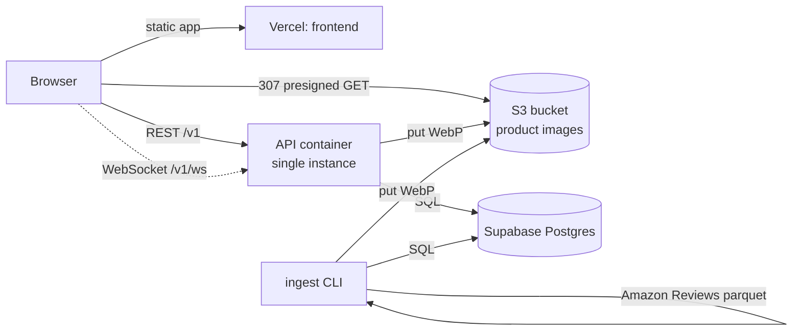

# Deployment

Web on Vercel, API on a container host (or Vercel Functions), Postgres on
Supabase, product images in an S3 bucket.



## Read this first: the API is stateful

Live game state lives in the API process, not in the database:
`impl/engine/registry.py` holds rooms, session tokens and WebSocket tickets in
memory, and each room runs its own timer task (`RoomEngine.start_timers`). The
database is a write-through record of what happened (players, cards, guesses,
votes, events), not the source of truth for a room in progress.

That single fact decides where the API can run:

| Host | Works? | Why |
| --- | --- | --- |
| One always-on container (Fly, Railway, Render, Cloud Run, VPS) | **Yes — recommended** | One process holds every room, timers run, WebSockets stay open |
| Vercel Functions | Partly, see [Option B](#option-b-vercel-functions) | Stateless and horizontally scaled: a request can land on an instance that never saw your room (`ROOM_NOT_FOUND`), and cold starts wipe rooms |

Two adjustments make the Vercel path as correct as it can be, and both are
already in the code (they are inert when `VERCEL` is unset):

- `VERCEL=1` → the in-process sweeper is not started; every request ticks the
  rooms instead (`registry.tick_all`), so deadlines, drips and slides advance
  from request traffic. The client polls every 2s when the WebSocket is not
  available, which is a fine tick source.
- `POST /v1/system/tick` (admin token, not in the OpenAPI document) advances
  every room and expires stale ones, for a scheduler to call.

Everything else below is independent of that choice.

## 1. Supabase (database)

1. Create a project. Pick the region closest to your API host — every game
   request hits this database.
2. Dashboard → **Connect** → copy the string for your runtime:

| Runtime | Use | Example |
| --- | --- | --- |
| Container / VPS | Session pooler, port 5432 (IPv4, supports prepared statements) | `postgresql://postgres.<ref>:<pw>@aws-0-<region>.pooler.supabase.com:5432/postgres` |
| Vercel Functions | Transaction pooler, port 6543 (IPv4, no prepared statements) | `postgresql://postgres.<ref>:<pw>@aws-0-<region>.pooler.supabase.com:6543/postgres` |
| Host with IPv6 (or the IPv4 add-on) | Direct, port 5432 | `postgresql://postgres:<pw>@db.<ref>.supabase.co:5432/postgres` |

Percent-encode reserved characters in the password (`@`, `#`, `?`, `/`, `&`,
space). On the free plan the direct host is IPv6-only, so an IPv4-only host must
use the shared pooler.

3. Set `DATABASE_URL` to that string, verbatim. The app normalises it
   (`impl/db.py:normalize_database_url`): `postgres://` and `postgresql://`
   become the `psycopg` driver, and a non-local host without an explicit
   `sslmode` gets `sslmode=require`, which Supabase requires.

   Transaction pooler (6543) additionally needs prepared statements off. Set
   `VERCEL=1` (automatic on Vercel) or `DB_PREPARE_STATEMENTS=0`, and the app
   passes `prepare_threshold=None` to psycopg. `DB_POOL_SIZE` defaults to 1 in
   that mode, because the number of warm function instances is not under your
   control.

4. Nothing else to run. The schema is created on API startup
   (`SQLModel.metadata.create_all` in the lifespan) together with reference data
   (categories, banned words). There are no migration files in this repo; the
   tables are plain SQLModel/SQLAlchemy models in `impl/tables.py`.
5. Optional demo catalog: `SEED_FIXTURES=1` seeds 12 categories and 24
   deterministic products (image bytes go to your image storage).
6. Leave Row Level Security out of the picture: the API talks to Postgres as
   `postgres` over the pooler, and the Data API (PostgREST) is not used. Never
   put the database password in the browser bundle.

## 2. S3 (the Amazon product images)

What the ingest does (`impl/ingest.py`): streams the pinned Parquet export of
`McAuley-Lab/Amazon-Reviews-2023` (`raw_meta_All_Beauty`), maps
`title`, `description`, `price`, `images`, `main_category`, `average_rating`,
`rating_number`, converts prices to cents, keeps USD $2–$500, decodes each
image, re-encodes it as metadata-stripped WebP, and stores it under
`products/<sha256>.webp` with width/height/byte size in `product_images`.
Re-running is idempotent: an image whose content hash already exists is skipped.

- `ingest.yaml` — 20 rows, the smoke config.
- `ingest.production.yaml` — the same pinned file with no row limit (112,590
  records). It covers Beauty & Personal Care only, because that is what this
  Parquet export contains; other Amazon categories are separate configs.

### AWS S3 setup

1. Create a bucket: private, Block Public Access on, in the region next to your
   API. A separate bucket for this app keeps the policy simple.
2. Create an IAM user (programmatic access only) with this policy, replacing the
   bucket name:

```json
{
  "Version": "2012-10-17",
  "Statement": [
    {
      "Effect": "Allow",
      "Action": ["s3:PutObject", "s3:GetObject", "s3:DeleteObject"],
      "Resource": "arn:aws:s3:::YOUR-BUCKET/products/*"
    },
    {
      "Effect": "Allow",
      "Action": ["s3:ListBucket"],
      "Resource": "arn:aws:s3:::YOUR-BUCKET"
    }
  ]
}
```

3. Set the API/ingest environment:

```
MEDIA_BACKEND=s3
S3_BUCKET=YOUR-BUCKET
S3_REGION=us-east-1
S3_ACCESS_KEY_ID=AKIA...
S3_SECRET_ACCESS_KEY=...
# S3_ENDPOINT_URL only for non-AWS endpoints (MinIO, R2, Supabase Storage)
# S3_KEY_PREFIX= optional prefix inside the bucket
```

### How images reach the browser

`imageUrl` is HMAC-signed with `IMAGE_URL_SECRET` and scoped to the card's
author during the AUTHOR phase (the guesser never receives it before REVEAL).
`GET /media/products/<key>` verifies signature, expiry, room and player, checks
the `product_images` row, then returns a **307 redirect to a short-lived S3
presigned URL** (`S3_PRESIGN_TTL_SECONDS`, default 120s). The bucket stays
private, the bytes never transit the API, and scoping stays enforced by the app.

No bucket CORS rule is needed for `` rendering. Add one only if you ever
read pixels from the canvas.

### Alternatives to AWS

Any S3-compatible endpoint works by setting `S3_ENDPOINT_URL` (path-style
addressing is used automatically):

- **Supabase Storage** — no second account: endpoint
  `https://<ref>.storage.supabase.co/storage/v1/s3`, region = your project
  region, credentials from *Storage → S3 access keys*.
- **MinIO** locally — the bundled compose stack does exactly this.
- **Cloudflare R2** — `https://<account>.r2.cloudflarestorage.com`, region
  `auto`.

### Running the ingest

```bash
# Locally against Supabase + S3
cd backend
uv sync --extra ingest
PYTHONPATH=src uv run --extra ingest python -m openapi_server.impl.ingest --config ingest.yaml
PYTHONPATH=src uv run --extra ingest python -m openapi_server.impl.ingest --config ingest.production.yaml

# Inside the compose stack (env comes from .env)
docker compose --profile ingest run --rm ingest
docker compose --profile ingest run --rm ingest python -m openapi_server.impl.ingest --config ingest.production.yaml
```

The production run downloads tens of thousands of images: expect hours and a few
GB of objects. Check the catalog with the admin endpoint:

```bash
curl -H "Authorization: Bearer $ADMIN_TOKEN" "$API/v1/admin/products?limit=5"
```

## 3. Frontend on Vercel

1. Import the repository, set **Root Directory** to `frontend`. Vercel detects
   Vite and Bun (`bun.lock`); `frontend/vercel.json` pins the commands and the
   SPA rewrite.
2. Environment variables (Production and Preview):

```
VITE_API_BASE_URL=https://api.example.com/v1
VITE_WS_URL=wss://api.example.com/v1
```

`VITE_WS_URL` is the API base, not the socket path — the client appends
`/ws/<roomCode>`. Leave it empty to derive `ws(s)://` from
`VITE_API_BASE_URL`. Both are inlined at build time, so changing them needs a
redeploy.

3. Deploy: `cd frontend && vercel --prod` (or push to the connected branch).
4. Back on the API, allow the new origin and point signed URLs at the API:

```
PUBLIC_BASE_URL=https://api.example.com
CORS_ALLOW_ORIGINS=https://your-app.vercel.app,https://your-domain.com
```

`PUBLIC_BASE_URL` must be the origin the browser uses for the API, because
`imageUrl` is built from it.

## 4. API

### Option A: container host (recommended)

One always-on instance. Same image as the local stack:

```bash
docker build -t impulsebuy-api ./backend
docker run --rm -p 3000:3000 \
  -e DATABASE_URL='postgresql://postgres.<ref>:<pw>@aws-0-<region>.pooler.supabase.com:5432/postgres' \
  -e ADMIN_TOKEN='...' -e IMAGE_URL_SECRET='...' \
  -e PUBLIC_BASE_URL='https://api.example.com' \
  -e CORS_ALLOW_ORIGINS='https://your-app.vercel.app' \
  -e MEDIA_BACKEND=s3 -e S3_BUCKET='...' -e S3_REGION='us-east-1' \
  -e S3_ACCESS_KEY_ID='...' -e S3_SECRET_ACCESS_KEY='...' \
  impulsebuy-api
```

Host settings that matter:

- **Exactly one instance**, no autoscaling. Two instances means two disjoint
  sets of rooms.
- Allow long-lived connections (WebSocket) and raise the request timeout
  accordingly; the WS route is `/v1/ws/{roomCode}`.
- Health check: `GET /v1/health`.
- Do not put the container behind a platform that restarts it per request.
- Keep `MEDIA_ROOT` irrelevant by using `MEDIA_BACKEND=s3`.

Cloud Run example: `--min-instances=1 --max-instances=1 --timeout=3600
--session-affinity` (affinity is a belt-and-braces extra, not a requirement when
there is a single instance).

### Option B: Vercel Functions

```bash
cd backend
vercel link
vercel env add DATABASE_URL production   # ...and the rest
vercel --prod
```

`backend/index.py` re-exports the ASGI app from `src/openapi_server/main.py`
(Vercel looks for a `FastAPI` instance named `app` at a supported entrypoint;
`pyproject.toml` also declares `[tool.vercel] entrypoint = "index:app"`).
`backend/requirements.txt` is the runtime dependency set, and
`backend/vercel.json` sets `maxDuration: 60` plus a cron job.

- Vercel sets `VERCEL=1`, so the API skips the in-process sweeper, ticks rooms
  on every request, sizes the DB pool at 1 and disables prepared statements.
- The cron calls `POST /v1/system/tick` every 5 minutes. Vercel sends
  `Authorization: Bearer $CRON_SECRET`, and the route requires the admin token,
  so set `CRON_SECRET` to the same value as `ADMIN_TOKEN`. Hobby plans only
  allow daily schedules — if the deploy rejects `*/5 * * * *`, change it to
  `0 3 * * *` or drop the `crons` block (polling clients already tick rooms).
- WebSockets are supported on Vercel Functions (public beta): a connection pins
  to one instance and closes when the function reaches `maxDuration`. The client
  reconnects with backoff and polls every 2s meanwhile, so the game keeps
  working without it.

What you give up, concretely:

- A room created on instance A is invisible to instance B. With more than one
  warm instance, players in the same room can get `404 ROOM_NOT_FOUND`, and a
  cold start drops every in-progress room (the DB keeps the records, not the
  live room).
- Session tokens and WebSocket tickets are in-memory too, so a reconnect can
  fail against another instance.
- Fixing this properly means moving rooms into Postgres (state column + pub/sub
  or Redis) — a design change, not a configuration one. Use Option A if the game
  matters.

## 5. Local stack (docker compose)

```bash
cp .env.example .env
docker compose up --build
```

| Service | URL |
| --- | --- |
| web (nginx + built frontend, proxies `/v1` and `/media`) | http://localhost:8080 |
| api | http://localhost:3000/v1/health |
| MinIO console (image bucket) | http://localhost:9001 |
| Postgres | localhost:5432 |

The `storage-init` service creates the image bucket with
`backend/scripts/create_bucket.py` (boto3, retries while the object store
starts) and then exits. The object store itself is `pgsty/minio` from Docker
Hub: upstream MinIO stopped publishing images to Docker Hub and quay.io refuses
anonymous pulls, and this fork speaks the same S3 API. For production use AWS
S3, Supabase Storage or R2 — the API code path is identical.

`SEED_FIXTURES=1` seeds 24 demo products and uploads their images to MinIO, so
the S3 code path is exercised without an AWS account. `MEDIA_BACKEND=local`
switches to a container volume instead of MinIO (then the `minio` and
`storage-init` services are simply unused).

To run the same stack against Supabase, put your pooler string in
`DATABASE_URL` in `.env`. The bundled `db` service is then unused (it still
starts, harmlessly; `docker compose up api web` skips it).

**You cannot upload a compose file to Supabase.** Supabase hosts Postgres (and
Storage), not containers: the compose file is for your machine or a VPS, and
Supabase replaces the `db` service inside it.

## 6. Verification

```bash
API=http://localhost:8080            # or https://api.example.com

curl -s $API/v1/health
curl -s -X POST $API/v1/rooms -H 'content-type: application/json' -d '{"name":"Ana"}'

# Catalog after an ingest
curl -s -H "Authorization: Bearer $ADMIN_TOKEN" "$API/v1/admin/products?limit=5"

# Signed image: expect 307 with a Location pointing at your bucket
curl -sI "$API/media/products/<key>?exp=<exp>&sig=<sig>&roomId=<code>&playerId=<id>"
curl -sL -o /tmp/card.webp -w '%{content_type}\n' "$API/media/products/<key>?exp=<exp>&sig=<sig>&roomId=<code>&playerId=<id>"

# WebSocket (ticket comes from POST /v1/ws/ticket with X-Session-Token)
npx wscat -c "ws://localhost:8080/v1/ws/ABCD?ticket=<ticket>"
```

For a fast manual run set `TIME_SCALE=2` (phases run twice as fast) or
`TIME_SCALE=0.5` to make them longer while testing.

## 7. Operational notes

- `ADMIN_TOKEN` guards `/v1/admin/*` and `/v1/system/tick`; it is a Bearer
  token, not a session token. Generate both it and `IMAGE_URL_SECRET` with
  `python -c "import secrets;print(secrets.token_urlsafe(32))"`.
- Sessions, tickets and rooms are in memory: a restart ends in-progress games
  (players see `ROOM_NOT_FOUND` / `REJOIN_EXPIRED`). Final results and event
  history stay in Postgres.
- `ROOM_TTL_SECONDS` (default 1800) expires idle rooms; the sweeper collects
  them every 30s on a container, and on Vercel on the next request or cron tick.
- Image storage is the only thing that must be durable across restarts besides
  Postgres. If `MEDIA_BACKEND=local` on an ephemeral filesystem, images vanish
  on deploy.
